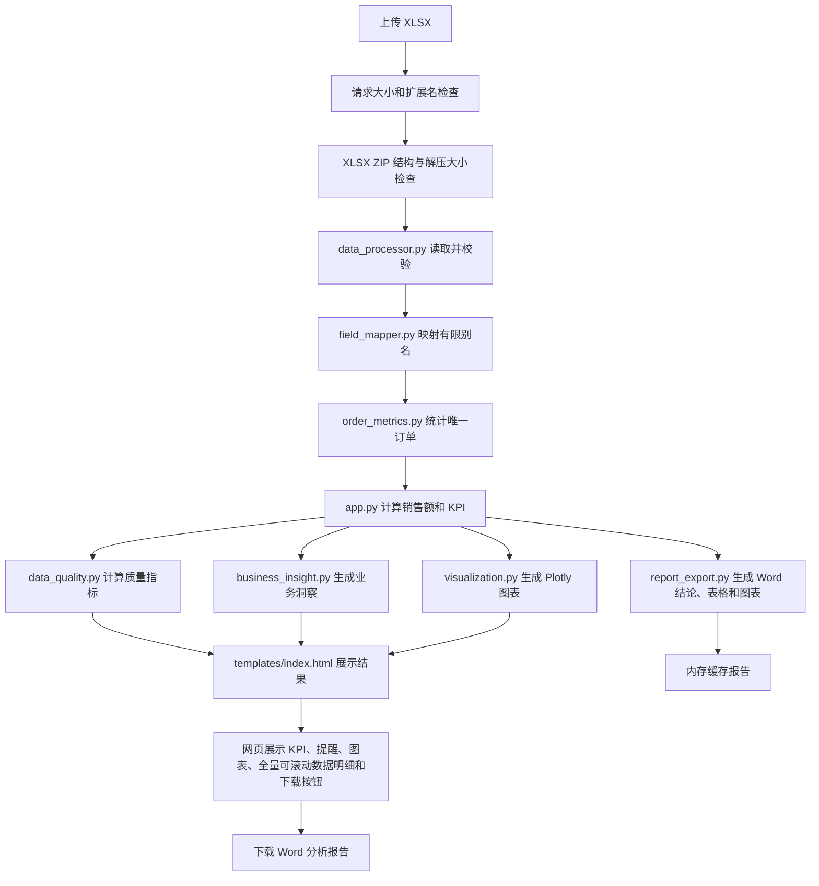

# Excel Insight V1.0

Excel Insight V1.0 是一个面向销售数据的本地 Web 分析工具。用户上传 `.xlsx` 文件后，应用检查文件结构和必要字段，映射有限范围内的中英文列名，计算销售指标、数据质量与业务洞察，并在网页上展示 Plotly 图表和可滚动查看的全部数据明细；用户可下载包含分析结论、关键数据和图表的 Word 报告。

## 项目背景

不同系统导出的销售表格可能使用不同的列名。这个项目把字段识别、基础校验、指标计算和可视化放在一个可复现的上传流程中，适合作为 Python、Flask 与数据分析能力的作品集项目。

## 已实现功能

- 接收 `.xlsx` 上传，限制整个 HTTP 请求体不超过 5 MiB。
- 检查 XLSX 必需文件，并限制 ZIP 条目数量和解压后总大小。
- 自动映射订单编号、数量和单价的有限别名。
- 验证表格非空、必要字段存在，数量与单价非空且为数值类型。
- 计算逐行销售额、唯一订单数、销售总额和平均订单金额。
- 计算缺失单元格、完整率、完整重复行和质量评分。
- 生成日期销售额峰值、销售额占比高于 50% 的商品、缺失值和重复行提醒。
- 使用 Plotly 展示每日销售趋势、每日非空唯一订单数、商品销售额 Top10、商品销售占比及商品数量标注。
- 在固定高度、支持上下和左右滚动的表格区域展示全部标准化数据行，表头滚动时保持可见。
- 下载 Word 分析报告，包含基于数据的结论、核心 KPI、每日趋势与商品汇总表、数据质量说明及三张图表。
- 将业务校验提示与未知内部异常分开处理；未知异常写入服务端日志，网页仅返回通用提示。

## 技术栈

| 技术 | 用途 |
| --- | --- |
| Python | 应用逻辑 |
| Flask | 上传请求和页面渲染 |
| Pandas | Excel 读取、字段校验和数据聚合 |
| OpenPyXL | XLSX 读取和演示数据写入 |
| Plotly | 交互式图表 |
| Matplotlib | 在 Word 报告中生成静态图表 |
| python-docx | Word 报告结构、表格和图表排版 |
| HTML、CSS、JavaScript | 分析页面和浏览器端图表渲染 |
| pytest | 自动化测试 |

浏览器端 Plotly.js 从 `cdn.plot.ly` 加载，因此查看交互式图表需要网络能够访问该 CDN。

## Excel 格式和字段映射

必须包含下列字段。`order_date` 与 `product` 当前只接受标准字段名；其他字段可使用表中列出的别名。

| 标准字段 | 支持的列名 |
| --- | --- |
| `order_id` | `order_id`、`订单编号`、`订单号`、`order`、`id` |
| `order_date` | `order_date` |
| `product` | `product` |
| `quantity` | `quantity`、`数量`、`销售数量`、`购买数量`、`qty` |
| `unit_price` | `unit_price`、`价格`、`单价`、`售价`、`成交价`、`price` |

字段映射会忽略首尾空格并对英文列名忽略大小写；不会推断未列出的同义词、翻译日期/商品字段或处理重复的同义列。存在标准列名和别名时优先使用标准列名。

数量和单价必须是 Pandas 识别的数值类型；程序不会把诸如文本 `"三"` 自动转换，也不会自动填充空值或删除重复行。数量与单价缺失会阻止分析；其他列中的缺失值和完整重复行会保留并显示在质量分析中。

## 指标口径和限制

- 每行销售额 = `quantity × unit_price`。
- 销售总额 = 每行销售额之和。
- 订单数量 = 去除首尾空格后非空的唯一 `order_id` 数量；空值和空白订单编号不计入订单数。
- 平均订单金额 = 销售总额 ÷ 唯一订单数，保留两位小数；没有有效订单编号时显示 `0.00`。
- 同一订单编号可对应多行商品明细。空订单编号对应的明细仍计入销售总额、图表和数据行数，页面与报告另行显示空订单编号数量。
- 完整重复行只提示，不自动删除；重复明细继续计入销售总额。负数金额（例如退货记录）仍按原销售额公式参与汇总，本轮不改动该业务口径。
- 数据完整率 = `1 - 缺失单元格数 / 总单元格数`。质量评分从 100 分扣除缺失单元格率和完整重复行率对应的百分点，最低为 0 分。空 DataFrame 的质量分析函数返回完整率 100%，但上传流程仍拒绝空工作表。
- Pandas 缺失值指标按空单元格统计；空白订单编号（包括仅含空格的编号）单独统计，空格字符串不自动改写原始数据。
- 图表中的商品数量标注按整数格式显示；计算使用原始数值，字段校验不强制数量必须为整数。
- 日期趋势按可解析日期汇总；无法解析的日期不会进入趋势图。商品或日期是否缺失不会阻止分析，但缺失值会被质量分析提示。

## 系统流程



## 项目结构

```text
excel-insight/
├── app.py                    # Flask 上传流程、请求限制和结果组装
├── data_processor.py         # XLSX 读取、字段校验和日志
├── field_mapper.py           # 有限字段别名映射
├── data_quality.py           # 缺失、重复、完整率与质量评分
├── business_insight.py       # 销售峰值、商品占比和数据提醒
├── order_metrics.py          # KPI 与每日图表共用的唯一订单编号口径
├── visualization.py          # Plotly 图表聚合和 JSON 序列化
├── report_export.py          # 用网页分析结果生成 DOCX 结论、表格和图表
├── create_test_data.py       # 生成五类确定性的模拟 XLSX 数据
├── requirements.txt          # 运行与测试依赖
├── templates/index.html      # 上传、KPI、洞察、质量、图表和全量可滚动数据表
├── tests/                    # 单元及 Flask 工作流测试
├── data/demo/                # 五类虚构演示工作簿
├── TEST_REPORT.md            # 本次审查与测试结果
└── README.md
```

## 安装、演示与运行

当前已在 Python 3.13.9 环境验证。在项目根目录执行：

```powershell
python -m pip install -r requirements.txt
python create_test_data.py
python app.py
```

按以下步骤进行演示：

1. 在项目根目录运行 `python -m pip install -r requirements.txt` 安装依赖。
2. 运行 `python create_test_data.py` 生成五类虚构工作簿到 `data/demo/`。
3. 运行 `python app.py`，然后访问 <http://127.0.0.1:5001>。
4. 先上传 `data/demo/standard_sales.xlsx`，查看 KPI、业务洞察、数据质量和三张交互图；在可滚动表格中查看全部记录，再点击“下载 Word 分析报告”。
5. 可继续试用 `mapped_fields_sales.xlsx`、`low_quality_sales.xlsx`、`invalid_type_sales.xlsx` 和 `invalid_fields_sales.xlsx`，观察字段映射、质量提醒及校验错误反馈。

演示工作簿只含虚构销售记录，可重复生成。标准样例的验收结果为 3 个唯一订单、总销售额 7,100.00 元、平均订单金额 2,366.67 元。

分析成功页的“下载 Word 分析报告”按钮生成 `.docx` 文件。报告开头给出分析结论，随后列出与页面一致的核心 KPI、每日销售额 Top10 日期、商品销售额 Top10、数据质量说明，并嵌入销售趋势、商品 Top10 销售额与销量、商品销售结构三张图。结论复用网页已有业务洞察，并补充第一名商品的销售额与占比；报告不包含原始工作簿或内部异常堆栈。若商品明细含负数，构成图改用保留负值的柱状图，避免饼图把负数误作正向占比。报告下载内容保存在当前 Flask 进程的内存中，最多保留最近 8 份；服务重启或被后续报告淘汰后，旧链接会失效。

## 自动化测试

```powershell
python -m pytest -q -p no:cacheprovider --basetemp "$env:TEMP\excel-insight-pytest-v1"
```

V1.0 最近一次完整回归为 **42 项通过，0 项失败**。该结果是在全量可滚动数据表改动之前取得；本次页面更新尚未重新运行完整测试。之前的测试覆盖字段映射、唯一订单统计、每日趋势订单数、销售指标、质量评分、洞察生成、图表数据、XLSX 上传结构和大小限制、五类 Excel 工作流、Word 报告打开与网页指标一致性、报告内图表和结论、错误页面反馈及异常信息保护。详细结果和已知限制见 [TEST_REPORT.md](TEST_REPORT.md)。

## 使用截图

当前仓库尚未归档页面截图。作品集截图建议保存到 `docs/screenshots/analysis-result.jpg`，展示使用标准演示数据得到的 KPI、业务洞察、质量分析、图表和可滚动的完整数据表；不要把包含真实客户数据的工作簿或截图加入项目。

## 已知风险和后续事项

- 当前只支持单工作表默认读取；不能选择工作表，也没有字段映射确认界面。
- `order_date`、`product` 没有同义字段映射；数量与价格只按数值 dtype 校验，不验证日期格式、数值有限性、负数或业务区间。
- 报告下载使用当前 Flask 进程的有限内存缓存，适合本地单进程演示；多进程部署需改用共享缓存或持久化方式。
- 报告内静态图表的中文标签依赖运行环境安装中文字体；当前 Windows 环境可使用微软雅黑或黑体。
- 上传限制保护请求大小及 XLSX 展开大小，但公开部署仍需生产 WSGI、访问控制、CSRF 防护、限流及日志轮转等配置。当前服务绑定 `127.0.0.1` 且关闭 Flask debug，适合本地演示。
